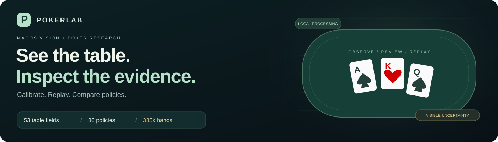
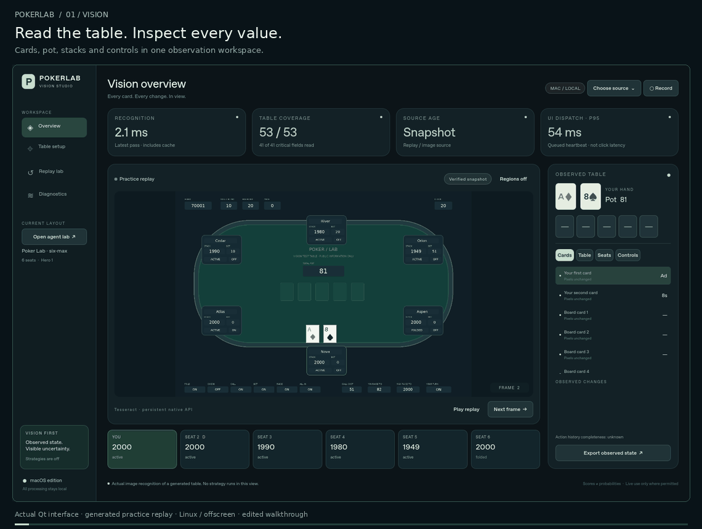
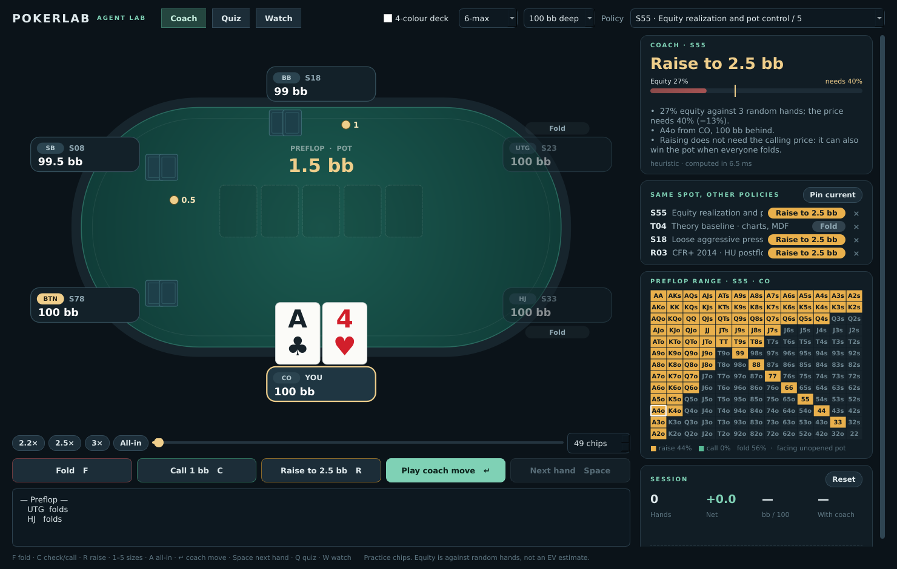
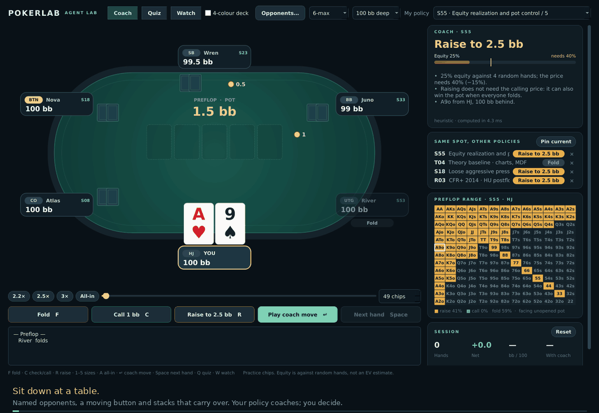

<p align="center">
  
</p>

<p align="center">
  <a href="https://github.com/msnouri/PokerLab/actions/workflows/macos-vision.yml"></a>
  <a href="https://github.com/msnouri/PokerLab/actions/workflows/repository-verification.yml"></a>
</p>

# PokerLab

**A research AI agent for testing and comparing poker strategies.** Explore
heuristic, CFR-family and textbook-theory policies, run reproducible benchmarks,
and play against them in a desktop lab that shows each policy's reasoning and ranges. Table vision, replay tools, and
on-device Apple Vision OCR connect observed table state to agent research.

[**Get started on Mac →**](#run-the-desktop-gui-on-mac) ·
[Agent Lab guide](docs/AGENT_LAB.md) ·
[Vision Studio guide](desktop/VISION_STUDIO.md) ·
[Research results](research/README.md) ·
[What is verified](docs/VERIFICATION.md)

## See the workspace in action



**Observe → calibrate → replay → inspect.** Follow cards, pot amounts, stacks,
controls and per-field uncertainty. Trace a reading back to its source pixels.
Save layouts and replay observations before changing the model.

| See the state | Keep the evidence | Compare the policies |
|---|---|---|
| 53 fields for a six-seat table, with explicit unknowns and stale-state checks | Calibrated regions, labelled examples, saved sessions and timing diagnostics | 80 heuristic configurations, six CFR-family research options and four reference-backed library policies; two- or six-player practice |

## Agent Lab: play a hand, see what every policy would do



`python -m desktop --lab` (or **Open agent lab** in Studio) deals a hand and
puts four things next to the table:

- **Coach** — the selected policy's move, with equity against the price.
- **Same spot, other policies** — pin up to five and see where they disagree.
  Above, S55 opens A4o from the cutoff and the chart-based T04 folds it.
- **Preflop range** — the policy is asked about all 169 hands in your exact
  spot, so the matrix is what it does, not a drawing of what it should do.
- **Session** — net big blinds, bb/100 and how often you matched the coach.

**Quiz** mode hides the answer until you act and grades the decision; **Watch**
lets the policy play your seat. Keyboard first: `F` `C` `R`, `1`–`5` for sizes,
`↵` for the coach's move, `Space` for the next hand. Advice, comparison and
range together take a few milliseconds. [Agent Lab guide](docs/AGENT_LAB.md).

PokerKit handles legal actions and settlement. S55 stays the default: neither
the reduced-game research proxies nor the library policies beat it here.

The first workbench, with the manual table reader, is still available as
`python -m desktop --classic`:



*Both GIFs and the Agent Lab screenshot show the actual Qt app with generated
practice tables, recorded on Linux/offscreen. They are edited walkthroughs, not live-client recordings or
latency benchmarks. [Recording script and provenance](docs/VERIFICATION.md#readme-demo-provenance).*

## Evidence you can inspect

- **Native Mac CI:** Apple Silicon and Intel, GUI/worker/observation checks,
  research-solver checks and native Apple Vision replay. JSON artifacts are
  uploaded by each job. [Verification ledger](docs/VERIFICATION.md).
- **Recorded Mac replay:** 1,270/1,272 fields read on ARM and 1,268/1,272 on
  Intel, with zero wrong accepted values. Changed-frame recognition p95:
  **1.36 s / 3.54 s**. These 24-frame calibrated fixtures exclude capture,
  display and startup; live end-to-end performance still needs device testing.
- **Research you can rerun:** 18 papers and **385,000 hands** across the initial
  and revised paper-policy experiments, with raw outcomes, paired confidence
  intervals and frozen-model hashes. [Research PDF](research/poker_research_report.pdf)
  · [LaTeX](research/poker_research_report.tex) · [Reading list](research/READING_LIST.md).
- **Original study and external comparison:** book-inspired policies, validation,
  tournaments and adapted open-source opponents. [Original PDF](report/poker_agent_report.pdf)
  · [LaTeX](report/poker_agent_report.tex).

## Findings

- 80 original heuristic policies: 16 families with five parameter variants.
- Every candidate completed 500 direct self-play hands and 500 common-opponent
  hands; 25 shortlisted candidates received 2,000 fresh validation hands each.
- Eight finalists were evaluated in 3,072 eight-player sit-and-gos. S55
  (equity realization and pot control) had the highest mean across the three
  tested fields, without statistically separating from every finalist.
- External comparison: 70,000 heads-up hands, 35,000 eight-player cash hands,
  and 896 tournaments against seven adapted Neuron Poker example policies.
- S55 led those tournament comparisons but lost heavily to aggressive
  example policies in heads-up cash play. That external comparison did not
  benchmark a pretrained DQN or CFR policy. The separate research study tests
  our own reduced CFR-family blueprints. **No general superiority claim is supported.**

- Library policies (T01–T04: Nash jam-or-fold solved in this repository,
  solver-frequency opening by seat, minimum-defence-frequency play with
  geometric sizing, and their combination): 64,000 paired hands per policy
  across four formats. None beats S55 six-max; the MDF policy loses about
  98 bb/100 to the baseline field at 100 bb.
  [Results](poker_lab/library_results/README.md) ·
  [sources](docs/STRATEGY_REFERENCES.md).

The simulations assume ordinary two-card no-limit Texas Hold'em. Tournament
payouts and the full blind schedule are research assumptions, not a verified
event submission. Read the report's methodology and adapter limitations.

## Repository contents

| Location | Contents |
|---|---|
| [`report/`](report/) | Combined LaTeX report, PDF, figures, and data-driven tables |
| [`poker_lab/pokerlab/`](poker_lab/pokerlab/) | Agent, 80-policy registry, PokerKit wrapper, experiments and analysis |
| [`poker_lab/results/`](poker_lab/results/) | Initial screening, validation and tournament raw/summary results |
| [`poker_lab/strategies.csv`](poker_lab/strategies.csv) | All 80 numerical configurations and conceptual attribution |
| [`github_comparison/`](github_comparison/) | External-policy adapter, source downloader, results and source inventory |
| [`poker_lab/tests/`](poker_lab/tests/) | Legality, determinism, information boundaries, equity and settlement checks |
| [`desktop/`](desktop/) | Vision Studio, Agent Lab, first workbench, calibrated vision, tests, and Mac setup guide |
| [`poker_lab/pokerlab/library/`](poker_lab/pokerlab/library/) | Plug-in policies T01–T04, the push/fold solver, and their paired benchmark |
| [`docs/`](docs/) | [Agent Lab](docs/AGENT_LAB.md), [adding a strategy](docs/ADDING_A_STRATEGY.md), [roadmap](docs/ROADMAP.md), verification ledger |
| [`packaging/`](packaging/) | PyInstaller recipe for a Mac app bundle (unsigned; untested on macOS) |
| [`research/`](research/) | Paper catalog, BibTeX, research report, figures and reproduction guide |
| [`poker_lab/research_results/`](poker_lab/research_results/) | Frozen-policy benchmark, duplicate-deal raw hands, retained initial screen |

## Run the desktop GUI on Mac

Requires macOS 13+ and Python 3.12, on Intel or Apple Silicon. Download this
repository, extract it, and double-click **Launch Poker Lab.command**. The
launcher installs the GUI dependencies in a local virtual environment on its
first run. If Finder does not launch it, open Terminal in the extracted folder:

```bash
bash "Launch Poker Lab.command"
```

Vision Studio starts with a generated replay that the reader actually analyzes.
On Mac, number/text OCR uses Apple Vision; no Tesseract installation is needed
for Studio. Live capture requires Screen Recording permission. Each external
table design needs its own calibrated regions and labelled visual examples.
This is a source application, not a signed standalone `.app`.

See the [Vision Studio guide](desktop/VISION_STUDIO.md) for setup, the complete
feature table, data fields, benchmarks, and remaining native-device checks.
The **Open agent lab** button in Studio, or `bash "Launch Poker Lab.command" --lab`,
opens the [Agent Lab](docs/AGENT_LAB.md): two- or six-player practice at five
stack depths with all 90 policies, including research options R01–R06 and
library policies T01–T04, each showing whether its own model or the S55
fallback produced the action. `python -m desktop --classic` opens the first workbench.

## Install and test

Python 3.12+ is recommended; the recorded experiments used Python 3.12.14.

```bash
python3 -m venv .venv
source .venv/bin/activate
python -m pip install -r requirements.txt
make test
```

## Reproduce the original experiment

```bash
cd poker_lab
python -m pokerlab.experiment --stage all --hands 500 --validation-hands 2000 --tables 128 --workers 8
python -m pokerlab.analyze
python -m pokerlab.bot < example_observation.jsonl
```

The bot defaults to S55. Choose a different candidate with `--strategy S01`
through `--strategy S80`, a research option `R01` through `R06`, or a library
policy `T01` through `T04`. To add your own, see
[Adding a strategy](docs/ADDING_A_STRATEGY.md).
The JSON interface is neutral and requires mapping
to a competition's actual SDK.

## Reproduce the external-policy comparison

From the repository root:

```bash
python github_comparison/download_sources.py
PYTHONHASHSEED=0 python github_comparison/benchmark.py --deals 5000 --tables 128 --workers 8
python github_comparison/build_report.py
```

The downloader obtains only the pinned, reviewed example source files and
license. Those files are ignored by Git. Both policies use our shared equity
feature; the native Neuron Poker environment and its full equity pipeline
are not reproduced. Read [`github_comparison/README.md`](github_comparison/README.md).

## Compile the LaTeX report

Use a normal TeX Live installation containing `pdflatex`, `geometry`,
`graphicx`, `booktabs`, `tabularx`, `longtable`, `xcolor`, `hyperref`,
`microtype`, `enumitem`, `fancyhdr`, and Latin Modern fonts (`lmodern`).

```bash
make report
```

`report/build_tables.py` regenerates numerical tables from the tracked CSVs.
It does not rerun any poker matches. The included PDF corresponds to the
included source and recorded results. Raw simulation outcomes are seeded;
timing and floating-point presentation can vary by platform.

## Attribution and scope

The report attributes concepts to the reviewed instructional books and names
the inspected GitHub projects. Parameter values and the heuristic policy
implementations are experimental choices, not author-prescribed systems.
The uploaded books and their extracted text are not part of this repository.

The project uses PokerKit and eval7; Treys is used for independent evaluator
tests. See [`THIRD_PARTY_NOTICES.txt`](poker_lab/THIRD_PARTY_NOTICES.txt).
The source downloader preserves the external project's license. No external
API is used during gameplay, and no poker client is automated. Major poker
sites prohibit bots and real-time assistance; PokerLab is for practice tables,
benchmarks and study. See the scope note in the [roadmap](docs/ROADMAP.md).
