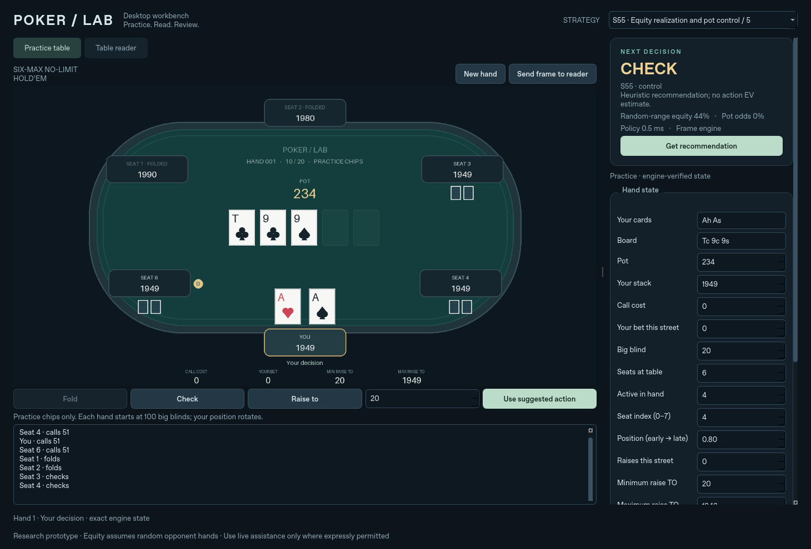

# Poker Lab desktop workbench

A local Python/Qt GUI for the existing Poker Agent Lab policies. The default
game is six-player no-limit Texas Hold'em, with practice chips and 100-big-blind
starting stacks. The interface does not depend on a commercial poker site.



## Mac setup

1. Use **macOS 13 or later**, on either Intel or Apple Silicon. Install
   **Python 3.12** from [python.org](https://www.python.org/downloads/macos/).
   The pinned card evaluator supplies universal Mac wheels for Python 3.12.
2. Download the repository with GitHub's **Code → Download ZIP** and extract it.
   Double-click **Launch Poker Lab.command**. Its first run installs the pinned
   packages in `.venv`; later launches reuse them. Internet is needed for the
   initial installation, but gameplay and recognition are local.
3. If Finder does not execute the launcher, open Terminal in the extracted
   repository and run:

   ```bash
   bash "Launch Poker Lab.command"
   ```

For a manual setup:

```bash
python3.12 -m venv .venv
source .venv/bin/activate
python -m pip install -r requirements-gui.txt
python -m desktop
```

This is a source application with a launcher, not a signed/notarized Mac `.app`.
The launcher does not install Homebrew, Python, or system tools automatically.

## Try it immediately

Open **Practice table**, press **Get recommendation**, then choose Fold,
Check/Call, Raise to, or **Use suggested action**. Only the internal practice
table accepts actions from this app. Five independent heuristic opponents play
their turns. **New hand** rotates your position and resets all stacks to 2,000
chips, with blinds of 10/20. The action log and bet bounds come from PokerKit.
Opponent hole cards are not passed to the advisor or shown in the GUI.

The strategy selector exposes all 80 original policies, defaulting to S55.
Changing a state field, mode, layout, or strategy invalidates the old suggestion.
The equity display is the policy's small-sample equity estimate against random
opponent hands. It is not the probability the recommendation is correct, an
action expected-value calculation, or a confidence interval. Earlier benchmark
weaknesses against aggressive opponents still apply.

## Read a table image or an authorized live table

For number OCR, install the optional
[Tesseract engine](https://tesseract-ocr.github.io/tessdoc/Installation.html).
If Homebrew is already installed:

```bash
brew install tesseract
```

Both `/opt/homebrew/bin/tesseract` and `/usr/local/bin/tesseract` are detected.
Practice play and manual state review work without Tesseract.

1. Open **Table reader**. Use **Load image** for a saved table image, or select
   a display and press **Capture**. On Mac, allow Screen Recording for the
   launching Terminal/Python application in **System Settings → Privacy &
   Security**, then quit and relaunch the application. Capture coordinates come
   from the captured display rather than Qt window coordinates.
2. To restrict live capture, select **Table bounds (crop display)** and drag
   around the table. This clears the old field regions. **Full display** resets
   the crop and regions. Keep the table on the same display and at a fixed size.
3. Choose a field and drag a tight rectangle around each whole visible card
   or numeric value. Calibrate both hole cards, all five board slots, pot,
   remaining stack, call cost, and your bet on this street. Raise-to bounds may
   also be calibrated if the table displays them. Draw numeric regions around
   amounts only, excluding labels and action buttons.
4. The bundled 52-card templates match the practice artwork. For a different
   design, select a card region, choose its correct label, and press **Teach
   card**. Add labelled examples for the cards the table may show, then
   **Save layout**. This first version uses one whole-card template per card;
   it does not contain a pretrained recognizer for arbitrary poker clients.
   Layout JSON and its relative `templates/` folder must stay together.
5. Press **Read this frame**, or **Scan until stable**. The latter reads
   repeatedly without queuing overlapping recognition jobs, then stops after
   two matching complete reads. Scores are similarity/OCR diagnostics, not
   calibrated probabilities. Unread fields are highlighted and retain their
   previous values for manual correction; they must be checked.
6. Review **all** state fields, including seats, active players, position,
   raises this street, whether you raised preflop, and whether you checked.
   This version does **not** infer the full betting history, dealer movement,
   player occupancy, or all-ins from arbitrary table graphics. Confirm the
   review checkbox and request a recommendation. Captured live frames expire
   after 10 seconds. Re-capture and review for each new decision.

**Send frame to reader** transfers the practice table image and matching
regions for an immediate OCR demonstration. The other hand-history/context
fields are provided by the practice engine in that demonstration. The rendered
image is what the card and amount reader actually analyzes.

## Amount conventions

- Every amount uses the same **integer chip unit**. With dollar-and-cent
  displays, choose **Chip scale ×100**, so `$1.50` becomes `150`; set the
  big blind and other manually entered amounts in cents too.
- Decimal dots and comma thousands separators are supported. Ambiguous comma
  decimals, unreadable text, and fractional scaled chip values are rejected.
- Pot includes chips already bet, including the opponent bet being faced.
  Call cost is capped at the remaining stack. Your bet is your contribution on
  the current street, not the entire hand.
- **Raise TO** includes chips already bet this street. Both bounds must be
  supplied together. Set both to **Unavailable** when raising is not legal or
  its legal bounds cannot be confirmed. `NONE` in the practice image represents
  unavailable bounds.
- Seat index is zero-based, relative to the small-blind-first ordering used by
  the engine. Position runs from 0 (early) to 1 (late). Table reader users must
  map these manually; the screen reader does not infer seat order.

## Validation and timing

From an activated GUI environment:

```bash
make test-gui
python -m desktop.benchmark --frames 20
```

The desktop tests exercise card/state validation, strict amount parsing,
profile boundaries, all 52 cards after resizing, unknown-art rejection,
interactive chip conservation and legal actions, real Tesseract OCR, review
requirements, stale frames, and invalidated asynchronous results. OCR tests
skip when the optional engine is unavailable. The original eight core tests
remain available through `make test` with the development dependencies.

[`validation.json`](validation.json) records the image-to-policy benchmark on
Linux. It uses 20 exact crops of our own rendered artwork across preflop,
flop, turn and river. Betting history/context comes from the engine. It excludes
native screen capture and human review, and is **not** an accuracy/latency
claim about an external client or Mac. Mac wheel availability is checked for
both CPU architectures; native Mac capture and the Finder launcher still need
on-device verification.
The resolved wheels are recorded in [`mac_compatibility.json`](mac_compatibility.json).

The recorded run passed 15 desktop tests and the eight original core tests.
All 20 benchmark frames were read correctly, with a 623.44 ms median and
799.70 ms maximum image-to-policy time on the recorded Linux machine. This
small in-domain result excludes capture/review and does not establish
recognition accuracy on other artwork or computer configurations.

Recognition has a four-second budget, and policy results arriving after five
seconds are discarded. Work runs outside the GUI thread. These are software
budgets, not verified maximum end-to-end response times for every computer.

## Scope and references

Use live decision assistance only in games that explicitly permit it. The app
does not click commercial poker clients or place external bets. Saved images
can be reviewed after a session. There is no hidden-information access, site
integration, anti-detection behavior, or general winning claim.

Implementation references:
[Qt for Python](https://doc.qt.io/qtforpython-6/gettingstarted.html),
[MSS examples](https://python-mss.readthedocs.io/latest/examples.html),
[Tesseract](https://tesseract-ocr.github.io/tessdoc/Installation.html).
Practice card artwork is generated by this project with Pillow; matching
features use OpenCV/NumPy. The GUI leaves the original policy implementation,
simulation results, and LaTeX report unchanged.
