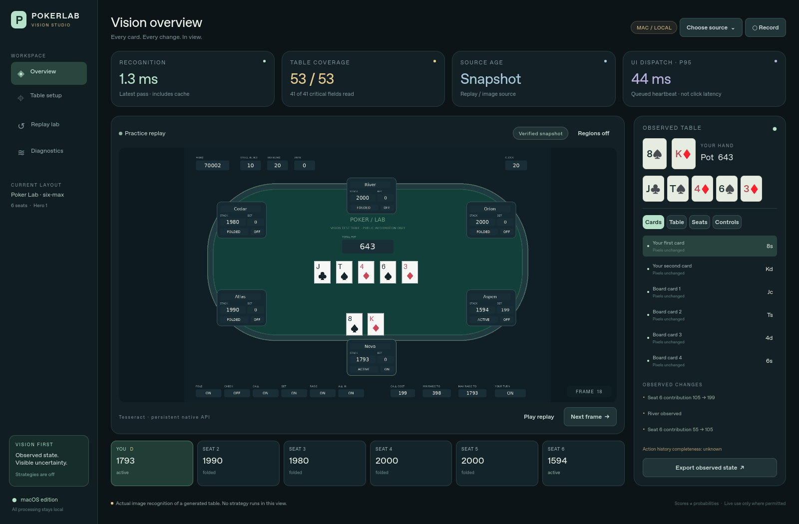

# macOS Vision Studio

Vision Studio is the new default GUI. It focuses on observing a poker table,
checking the readings, and recording evidence for future strategy models.
The previous strategy workbench remains available with `--classic`.



## The complete GUI improvement plan

| Goal | Implemented in Studio | How to check it |
|---|---|---|
| Smooth interaction during recognition | Qt Quick interface; capture callbacks, OCR and image registration run outside the UI thread; one persistent recognition process | UI heartbeat dispatch P95/P99 in Diagnostics; test all four views; test while replay is advancing |
| Fast, fresh updates | Exact-pixel field cache; persistent OCR and card features; capture-to-UI mailbox keeps only the latest image; one OCR processing frame and one replaceable pending frame; 3.5 s soft reading budget and 5 s worker watchdog | Changed-image and repeated-image timings are reported separately; old results are discarded; watchdog and both queue tests |
| Reliable Mac window tracking | ScreenCaptureKit selected-window capture, configured at 20 fps; explicit high-resolution output capped at 1920 × 1300; window-size updates and optional visual anchor registration | Move and resize the selected window on the target Mac; lost anchors reject the state; normalized coordinates avoid desktop-offset assumptions |
| Faster calibration | Card-region proposals, drag-to-set regions, explicit confirmation, labelled card/indicator examples, learned empty board slots, reusable layouts | Table setup overlays; proposals remain unread until confirmed; new artwork requires examples |
| Visible uncertainty | Per-field unknown/read/confirmed/stale states; card/chip/dealer checks; two matching observations; live expiry after 5 s; manual correction tied to exact pixels | Coverage and critical-field counts; conflicting/expired readings are withheld; export includes validity and missing critical fields |

These are implemented design improvements, not a measured speed or accuracy
victory over `dickreuter/Poker`. That project already uses background Qt work
and persistent native OCR. A comparison needs the same labelled video, machine,
table artwork and timing boundaries for both implementations.

## Start on a Mac

Use macOS 13+ and Python 3.12 on Apple Silicon or Intel. Download this repository,
extract it, and double-click **Launch Poker Lab.command**, or run:

```bash
bash "Launch Poker Lab.command"
```

For manual installation:

```bash
python3.12 -m venv .venv
source .venv/bin/activate
python -m pip install -r requirements-gui.txt
python -m desktop
```

Studio uses Apple's on-device Vision text recognition on Mac. Tesseract is not
needed for Studio on Mac. The Python controller calls native Apple capture/OCR
and Qt rendering; this does not require rewriting the application in C++.
There is no Windows capture implementation in this version.

Apple Vision reads large changed-field sets in a shared full-image pass, then
uses enlarged crops for small changed or uncertain numeric/text sets. Indicator
OCR retains wider context because tight ON/OFF crops failed native validation.
Calibrated visual indicator examples take precedence over OCR. Accurate and
focused fallback passes run within the reading budget when needed. Word geometry separates adjacent fields; text boxes crossing
field boundaries are withheld. OCR models
warm up once in the background before the first timed frame; startup has a
separate 30-second bound. PyObjC dependencies are aligned at 12.1 to avoid the
CoreMedia 13.0 Intel-wheel loading failure found by native CI.

This is a source application with a launcher, not a signed/notarized `.app`.
The initial dependency installation needs internet; observation is local.

## Four views

* **Overview:** actual source image, recognized cards, per-seat summaries,
  field inspector, observation timeline and live timing cards.
* **Table setup:** field regions, visual examples, registration anchor,
  seat/hero configuration and chip scale.
* **Replay lab:** step, play and scrub generated or recorded frames.
* **Diagnostics:** recognition percentiles, cache use, source freshness,
  discarded results and snapshot coverage, with JSON export.

The opening demo is a generated six-seat table. The reader analyzes its rendered
pixels, using known card art and independently rendered labelled control/status
examples. Names and multi-digit amounts use OCR; single-digit and unavailable-bound
examples are also calibrated. Per-hand fixture labels enter only the separate
benchmark. No strategy runs in Studio. To use the existing practice game and all 86 selectable policies:

```bash
python -m desktop --classic
```

## Read your own table

1. Choose **Choose source → Screen Recording access**. Allow the launching
   Terminal/Python application in **System Settings → Privacy & Security →
   Screen Recording**, then relaunch if macOS requests it.
2. **Refresh windows**, choose the table window, and capture it. Prefer a window
   containing only the table. Capture retains the selected window identity
   when it moves; closing it requires choosing a new one.
3. Open **Table setup** to pause capture. Set seat count, your physical seat
   number, and chip scale. The inspector groups all fields into Cards, Table,
   Seats and Controls. Select a field and draw a tight rectangle around its
   visible value area, allowing room for wider future amounts. Drawing a region
   confirms it.
4. **Detect cards** proposes light-card regions. Review and confirm each
   proposal; it is a convenience for compatible artwork, not a general poker
   table detector. Draw missing or incorrect regions manually.
5. For different card artwork, teach a labelled example such as `As`. For a
   graphic dealer/turn/control indicator, teach `true` and `false` examples.
   Player-status examples use `active`, `folded`, `all-in`, or `empty`.
   A single positive example cannot establish reliable absence detection.
   For an empty board slot, select it and use **Learn empty slot**.
   You can also teach an exact displayed amount, such as `0`, using the selected
   chip scale. Numeric examples require a near-exact match; other values fall
   back to OCR. Changing chip scale clears numeric examples.
6. Optionally choose **Set anchor**, then draw a distinctive static feature
   inside the table. Registration checks supported uniform scaling and drift;
   changed aspect ratios, reflow, cropping or lost anchors require recalibration.
   Without an anchor, normalized regions alone cannot detect arbitrary reflow.
7. Save the layout. Keep its JSON, relative visual assets and anchor together.
   Resume capture from the Overview. Check the overlay and unknown fields.

Generic artwork and icon meanings are not inferred perfectly. Calibration and
representative labelled examples are required for each table design. Only
read information that is visibly available in the selected window. There is
no automatic clicking, betting or external strategy recommendation in Studio.

## Information available to future models

The version-2 observation schema supports 2–9 physical seats. Six seats produce
53 fields, of which 41 are treated as critical for the visual readiness label.

| Group | Fields |
|---|---|
| Cards | Your two cards and five board slots; a known empty slot is distinct from an unread slot |
| Table | Total pot, call cost, small/big blind, ante, minimum/maximum raise-to, displayed hand identifier |
| Each seat | Name, remaining stack, contribution on the current street, active/folded/all-in/empty status, dealer marker |
| Controls | Your-turn indicator, displayed timer, availability of fold/check/call/bet/raise/all-in controls |
| Derived observations | Street when every board slot is known; active/occupied counts when every seat status is known; observed changes and possible gaps |

Each field includes its value, quality, diagnostic score, reason, frame time
and cache status. Scores are OCR/template diagnostics, not calibrated
probabilities. Unknown values remain unknown rather than becoming zero.
Player-count summaries remain unknown if occupancy has not been established.

Amounts use one integer chip unit. With dollar-and-cent displays, choose
**×100**, so `$1.25` is exported as `125`. The same scale applies to every
amount. A displayed bet is the contribution on the current street; raise-to
bounds include that contribution. `NONE` represents unavailable bounds in the
generated demo. Other displays need equivalent readable text or manual review.

**Export observed state** saves the snapshot, table context, observed changes,
metrics, and explicit validity including current/expired status and missing
critical fields. Runtime timestamps are monotonic seconds within a session;
the export also includes UTC wall time. A future consumer must check validity,
unknowns and conflicts rather than treating exported fields as action-ready.

Two matching reads of critical fields can verify a visual snapshot; changes
to optional names or the timer do not prevent this check. They do not
establish a complete betting history, strategy correctness, legal actions on
an arbitrary site, or accuracy of a wrong template. The tracker labels changed
contributions and status, but does not invent calls/raises or their order.
`history_complete` remains false. Positions/ranges, side pots, prior aggressors,
exact action order and unseen activity require another verified data source.

## Record and replay

**Record** writes local PNG frames plus `session.json`, capped at 500 MB. It
records changed recognized states and the exact image used for each reading;
it is not a continuous 20 fps video recorder. Changing layouts ends the recording.
Sessions live in the application's local data directory under `VisionStudio/sessions`.
Open a session through **Choose source → Open replay** or Replay lab.

Recorded OCR is stored as `observed`. Its `ground_truth` starts as `null`.
To benchmark a real recording, independently check **all** field labels for
each evaluated frame, including explicit nulls, and add a `ground_truth` map.
Do not copy the reader's output as ground truth. The benchmark rejects
unlabelled or incomplete labels.

## Validation and measured speed

```bash
make test-gui
python -m desktop.v2.benchmark --backend vision --frames 24 --output mac-benchmark.json
python -m desktop.v2.benchmark --backend vision --frames 24 --min-coverage 0.98 --min-critical-coverage 0.85 --output mac-ci-benchmark.json
python -m desktop.v2.benchmark --backend vision --session /path/to/session.json --output replay-benchmark.json
```

Development on Linux can use the optional native Tesseract backend with
`requirements-vision-test.txt` and English Tesseract data. This is for tests and
replay development; the product target remains Mac.

The included [Linux replay measurement](validation-v2-linux.json) uses 24
generated labelled frames, 53 fields each. It uses independently rendered card,
indicator and single-digit artwork for calibration; remaining text and amounts
use OCR. No per-hand labels are used by the reader. It read **1,271 of 1,272 fields**
with **zero wrong accepted values**: **99.92% coverage**. One pot was
withheld. **23/24 frames had every field correct**, including every
critical field. This small in-domain test does not estimate accuracy on another
client, artwork or computer.

Changed-frame recognition measured **27.62 ms median, 68.67 ms P95**;
repeated pixels measured **1.30 ms median**. These measurements reuse the engine
and field cache and exclude screen capture, UI paint, review and startup. They
are Linux/native-Tesseract measurements, not Mac/Apple-Vision measurements and
not relative speedup figures. The first read, new artwork and cache expiry can
take longer. Known fields are rechecked after 30 seconds and unknowns after 2
seconds; any pixel change invalidates that field immediately. Small OpenCV ROI
kernels use one thread to avoid contention with capture and OCR. Inspect
changed-frame and repeated-frame numbers separately.

Native macOS CI also passed on both architectures at commit
`e5536de8fea5de5e5abc35c932d463159616885a`:

| Runner / Apple Vision | Fields read | Wrong accepted | All critical fields correct | All 53 fields correct | Changed P50 / P95 | Repeat P50 |
|---|---:|---:|---:|---:|---:|---:|
| Apple Silicon | 1,270/1,272 | 0 | 24/24 | 22/24 | 0.90 / 1.36 s | 1.63 ms |
| Intel | 1,268/1,272 | 0 | 22/24 | 20/24 | 1.93 / 3.54 s | 5.98 ms |

See the complete [Apple Silicon measurement](validation-v2-macos-arm64.json),
[Intel measurement](validation-v2-macos-intel.json), and
[successful native run](https://github.com/msnouri/PokerLab/actions/runs/43248833720).
Each Mac suite ran 64 desktop tests: 62 passed and two optional tests for the
legacy Tesseract workbench were skipped. All 13 research tests also passed on each architecture. Native Apple Vision, GUI rendering,
ScreenCaptureKit protocol imports and BGRA stride conversion were exercised.
The original eight engine tests also passed locally.

These are 24 generated, calibrated frames per architecture, using known card,
indicator and single-digit artwork plus native text OCR. They exclude live
screen capture, UI paint, human review and startup. Apple Silicon withheld two
optional minimum-raise readings; Intel withheld four values, including two
critical stack readings. Unread values remain unknown. Zero wrong accepted
values in this small fixture is not a production accuracy guarantee, and no
speed comparison against another repository was run.

Initial engineering targets for a calibrated single table are changed-frame
recognition P95 ≤250 ms, frame-to-observation P95 ≤750 ms, and warm queued UI
heartbeat P95 ≤50 ms. The native CI changed-frame P95 target was not met; the measured 1.36–3.54 s
reading P95 remains within the original 5–10 s decision-time goal for this
vision stage. Capture, strategy work and target-device UI latency still need
measurement before claiming an end-to-end decision time. UI heartbeat
delivery is not physical click latency, display FPS, or a complete end-to-end
decision benchmark. Strategy time is outside this version's scope.

The [macOS CI workflow](../.github/workflows/macos-vision.yml) runs on Apple
Silicon and Intel with API/stride-conversion checks, observation/worker/GUI
tests and a native Apple Vision replay benchmark. It runs on every push and
pull request, including documentation commits. Both fresh and repeated reads
must have zero wrong accepted values. CI also requires at least 98% field
coverage and 85% of frames with all critical fields correct, so an unusable
reader cannot pass merely by returning unknowns. Native Mac OCR initialization
errors fail the suite rather than skipping recognition tests. These are fixture
acceptance thresholds, not production accuracy guarantees. CI does not grant Screen
Recording or validate a real poker client's live capture, Finder permissions,
monitor changes or external artwork. Those require a session on the target Mac.

The [offscreen GUI smoke record](validation-v2-gui-linux.json) advances nine
rendered frames through the actual worker and all four views. Its queued UI
heartbeat P95 was **55.83 ms**, above the initial 50 ms target on this software
renderer. It is not a native Mac display test, physical
click latency, or a smoothness guarantee on the target machine.

## Implementation map

| Path | Responsibility |
|---|---|
| `studio.py`, `qml/Studio.qml` | Qt Quick interface and controller |
| `v2/mac_capture.py` | ScreenCaptureKit selected-window stream and BGRA conversion |
| `v2/ocr.py`, `v2/reader.py` | Persistent OCR, card/indicator features, field cache and abstention |
| `v2/runtime.py` | Replaceable pending frame, process watchdog and startup bounds |
| `v2/layout.py` | Versioned calibration, anchor registration and card-region proposals |
| `v2/state.py` | Field schema, consistency checks and conservative observed timeline |
| `v2/replay.py`, `v2/metrics.py`, `v2/benchmark.py` | Recording, distinct timing metrics and labelled evaluation |

The fixture renderer bundles DejaVu Sans for consistent test text; see
[`assets/DejaVu-LICENSE.txt`](assets/DejaVu-LICENSE.txt). Card artwork uses the
existing repository's rendered card templates. `v2/demo.py:write_examples`
creates labelled indicator and single-digit assets from fixed label strings independently of
the generated hands; these are saved with demo layouts and recordings. Uploaded books and private
table captures are not included in the repository.

For historical failures, signature status and the remaining device checks, see the [verification ledger](../docs/VERIFICATION.md).
