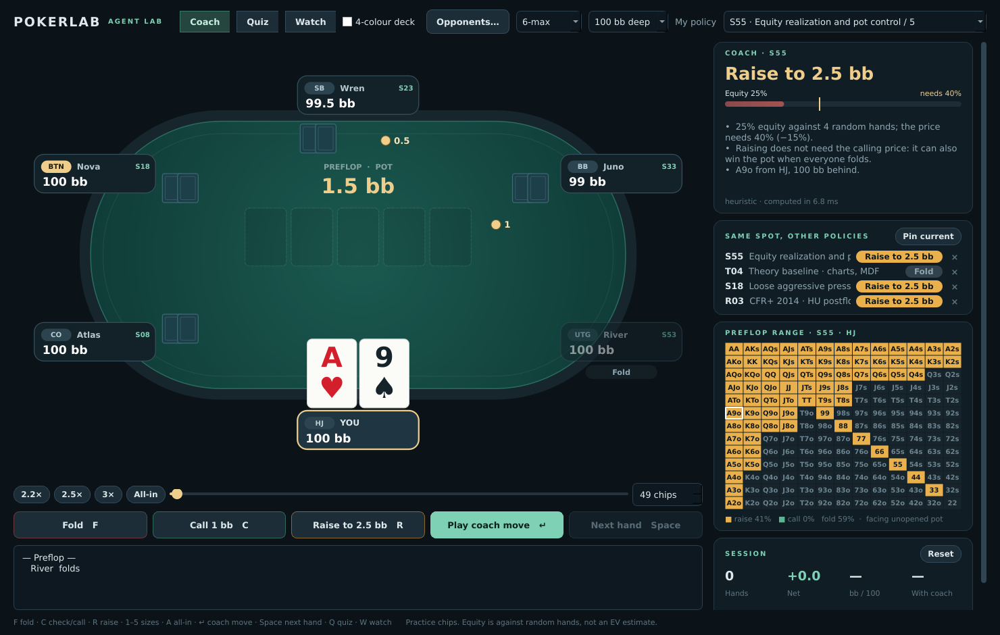
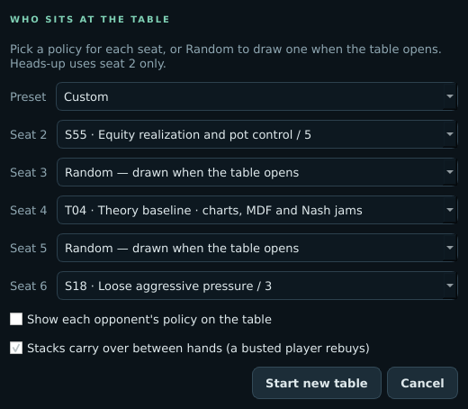
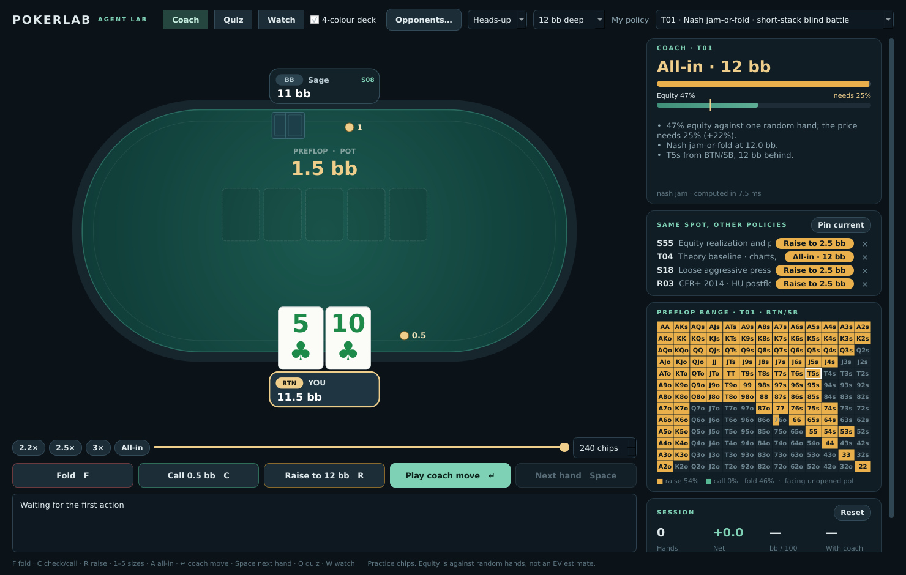

# Agent Lab



```bash
python -m desktop --lab            # or: bash "Launch Poker Lab.command" --lab
python -m desktop --lab --seed 120 # same deals and same random opponents every time
```

The lab opens on a hand that is already waiting for you. Everything on screen
is computed locally from the practice engine (PokerKit) and the selected
policy; it does not read the screen or talk to another program.

## What is on screen

| Area | What it shows |
|---|---|
| Table | Named players with position badges, their policy id (or `???`), stacks and bets in big blinds, last action per seat, the board, and opponents' cards only after a showdown they reached |
| Coach | The selected policy's action, its action mix when it reports one, equity against random hands next to the equity the price requires, and the facts behind the spot |
| Same spot, other policies | What up to five pinned policies do with the same cards and the same random variate |
| Preflop range | A 13 × 13 matrix built by asking the policy about all 169 starting hands in your current spot; split cells are mixed actions, your hand is outlined |
| Session | Hands, net big blinds, bb/100, how often your action matched the coach, and a running-result line |

## Opponents



**Opponents…** in the top bar chooses who you play against. Each seat takes any
of the 90 policies or **Random**, which draws one of the 84 heuristic and
library policies when the table opens. Presets fill all seats at once (mixed,
all random, tight, loose-aggressive, callers, five copies of S55). Untick
"Show each opponent's policy" and the table shows `???` instead of the policy
id, so you have to read each player from how they play.

The table runs like a cash game. Opponents have names and keep their seats, the
button moves one seat each hand, stacks carry over, and anyone who busts rebuys
to the chosen depth (the log says so). Untick "Stacks carry over" to restart
every hand at the chosen depth, which is the setting to use for the short-stack
policies. **My policy** is the one that coaches you; it is independent of the
opponents.

## Modes

- **Coach** shows the policy's move before you act. `↵` plays it.
- **Quiz** hides the move, the comparison and the preflop range until you act, then
  grades the decision: same action, same action with a different size, or different.
- **Watch** lets the policy play your seat, hand after hand.

## Keys

| Key | Action | Key | Action |
|---|---|---|---|
| `F` | Fold | `1`–`5` | Size presets |
| `C` | Check / call | `A` | Set the raise to all-in |
| `R` | Raise the shown amount | `↵` | Play the coach's move |
| `Space` | Next hand | `Q` / `W` | Quiz / Watch on and off |

## Table options

Six-max or heads-up, starting at 12, 25, 50, 100 or 200 big blinds. The short
depths are where T01 (Nash jam-or-fold) is in scope:



## What the numbers are not

Equity is a Monte Carlo estimate against uniformly random hands. It is not an
EV estimate and not a range-versus-range calculation. "Balanced range continues
about N %" is the minimum-defence-frequency formula, shown as context. Session
results are practice chips against the policies you seated.

The lab code is `desktop/lab.py` (window) and `desktop/labmodel.py` (everything
it displays; no Qt, tested headless in `desktop/tests/test_lab.py`).
