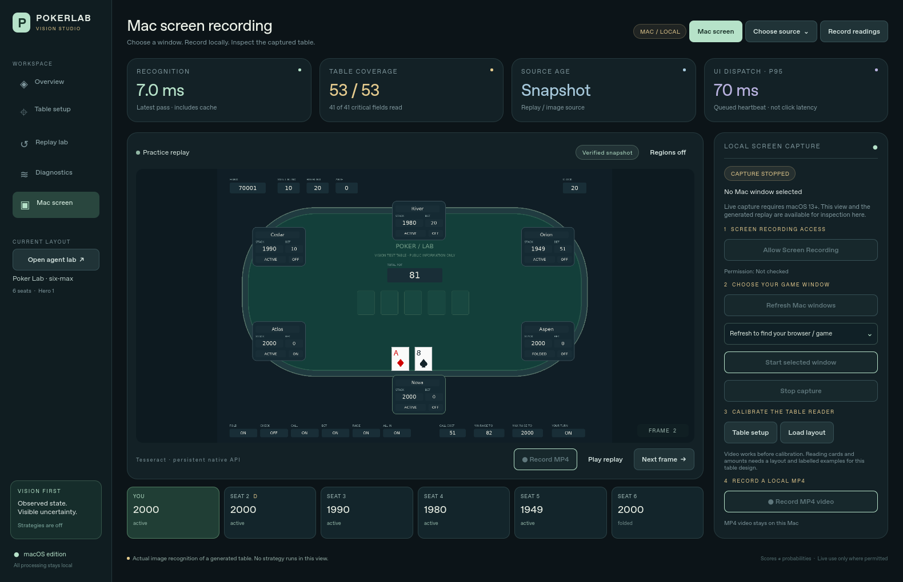

# Record a game window on your Mac

PokerLab can preview a selected Mac window and record a silent local MP4 while
the table reader works independently. Use a browser window containing your
practice game, or another game window you are permitted to capture. Nothing
is uploaded. No account, server, API key, or additional recording package is
needed after the GUI dependencies are installed.



The screenshot shows the actual Qt view on Linux with a generated practice
replay. Mac permission/window controls activate on macOS; this is not footage
of a captured online game.

## Start

Requires macOS 13+ and Python 3.12, on Apple Silicon or Intel. From the repository:

```bash
bash "Launch Poker Lab.command" --screen
```

With the GUI environment already activated, use `python -m desktop --screen`
or `make screen`. You can also choose **Mac screen** in Vision Studio's sidebar
or click **Mac screen ↗** in Agent Lab. Phone-camera input is a later extension.

## Select and preview a window

1. Open the game in its own browser or application window.
2. Choose **Allow Screen Recording**. In **System Settings → Privacy & Security →
   Screen Recording** (called **Screen & System Audio Recording** on some macOS
   versions), allow the application that launched PokerLab, usually Terminal
   or Python. If macOS asks, quit and relaunch PokerLab after granting access.
3. Click **Refresh Mac windows**. Choose the entry showing the application and
   game-window title, then click **Start selected window**.
4. Check the preview. Capture is restricted to that window, including its
   browser chrome, rather than the whole desktop. The preview can work before
   any table-reader fields are calibrated.
5. **Pause capture** freezes the preview; **Resume capture** resumes the same
   window. **Stop capture** ends sharing and clears the selection. A closed
   window or capture error stops the stream; choose the window again to retry.

The operating system's selected-window permission must be tested on your Mac.
CI exercises the native API imports and buffer conversion, but cannot grant
your Screen Recording permission or validate the artwork of an unknown game.

## Save video

Click **Record MP4 video**, choose a new filename and folder, then play your
test hands. Click **Stop video recording** to finish. Wait for the **Saved**
message before opening the clip. **Show recording folder** opens its location.
Pausing/stopping capture, changing sources, or closing PokerLab also ends the clip.
Existing recordings are never overwritten; choose a different filename.

| Output | Contents |
|---|---|
| `table.mp4` | Silent video of the selected window, targeting 10 frames/second using MPEG-4 encoding |
| `table.capture.json` | Source title, video dimensions, frame count, capture/encode timestamps, repeated frames, replaced pending frames, elapsed/playback duration and any recording error |

The recorder runs on a separate thread with one replaceable pending frame.
It samples the newest capture and repeats the most recent image when necessary;
it does not wait for OCR or queue a backlog of old frames. Window resizing is
letterboxed into the video's initial even-sized dimensions. Capture targets
20 fps, while video targets 10 fps; neither is a sustained-performance guarantee.

A clip stops after 30 minutes or when the observed file size reaches about
500 MB. Encoder buffering/finalization may add some bytes beyond that threshold.
Under sustained encoder overload, playback time can differ from wall time;
the sidecar preserves per-frame timing. The MP4 is lossy and is not a source of
ground-truth labels or a capture-to-decision latency benchmark.

## Read cards and amounts

Choose **Table setup**, which pauses capture and ends the current video. Draw
and confirm the table's regions, teach examples for unfamiliar cards/indicators,
set your seat and chip scale, and save the layout. Return to **Mac screen**,
resume capture, and check the readings in **Overview**. **Load layout** reuses
a saved layout and its relative visual assets. Each table design needs its own
calibration; there is no pretrained universal poker-table detector here.

**Record readings** is a different recording option. It saves lossless PNG
frames and `session.json` for changed recognized states. Open that JSON through
**Replay lab → Open recording**. This replay workflow preserves reader output
as observations and keeps ground-truth labels unset. MP4 clips open in a normal
video player; they are not imported by the JSON replay loader.

Vision Studio observes and exports table state. Strategy coaching remains in
Agent Lab's practice games and the classic workbench's manually reviewed
reader. This feature does not connect arbitrary live screenshots directly to
policy advice or automate a game's controls. A future advice bridge needs
validated positions, legal action bounds and betting history, not just pixels.
Use live assistance only where the venue explicitly permits it; free play
does not by itself establish that permission.

## If something fails

- **No windows / permission denied:** check the launching application's Screen
  Recording permission, relaunch it, and refresh the list.
- **Wrong window or unreadable table:** check the application/title in the list,
  preview it, and calibrate the correct layout. Capture does not make unknown
  artwork readable automatically.
- **Record button disabled:** start capture and wait for the first preview
  frame. Recording is unavailable for an image or replay source.
- **Encoder or disk error:** read the on-screen error, check the output folder
  and free disk space, and choose a new filename. The recorder reports errors
  instead of claiming a successful clip.
- **Slow updates:** inspect **Diagnostics**, use a smaller game window, and
  compare recording on/off on your actual machine. OCR latency, capture rate,
  video rate and display responsiveness are separate measurements.

Tests: `desktop/tests/test_screen_recording.py` writes and decodes an actual
MP4, covers resizing, encoder failure, limits, capture selection/permission
errors, stale callbacks, stopping and independence from OCR. GUI tests render
the new view and check that recording requires a live source. Native Mac CI
runs these checks on Apple Silicon and Intel. A real-window session remains
the user's device check; no external game is opened by the tests.
