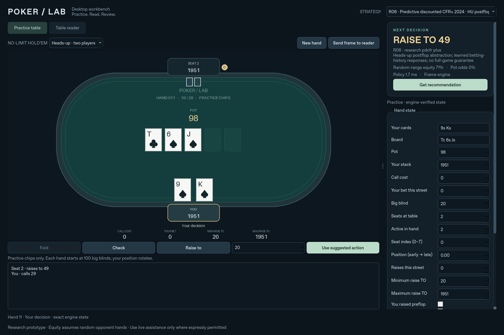

# Research strategies and evaluation

**Six working research options, 18 papers, and an unfavorable playing result.**
The algorithms converge in small imperfect-information games, but their current
Hold'em proxies do not beat S55. S55 remains the default. This is an evaluation
of our implementations and abstraction, not a reproduction of the champion
systems in the papers.

- [Report PDF](poker_research_report.pdf) · [LaTeX](poker_research_report.tex)
- [Linked reading list and citation counts](READING_LIST.md)
- [Machine-readable paper metadata](papers.json) · [BibTeX](papers.bib)
- [Final benchmark and raw hands](../poker_lab/research_results/)
- [Retained unfavorable first screen](../poker_lab/research_results/screening_v1/)
- [Implementation](../poker_lab/pokerlab/research/) · [Attribution](THIRD_PARTY_NOTICES.md)

## Choose an agent on Mac

Launch the existing Mac GUI, then click **Open agent lab** in Vision Studio.
Alternatively, run `python -m desktop --classic`. Choose **Heads-up · two players**
in the practice tab and select an R option from the strategy menu. The 80
original options are still available. The recommendation describes the active
policy path, including S55 fallback reasons.

| Option | Implemented method | Paper |
|---|---|---|
| R01 | Alternating CFR | Zinkevich et al., 2007 |
| R02 | External-sampling MCCFR | Lanctot et al., 2009 |
| R03 | CFR+ with linear averaging | Tammelin, 2014 |
| R04 | Discounted CFR | Brown and Sandholm, 2019 |
| R05 | Predictive CFR+ | Farina et al., 2021 |
| R06 | Predictive discounted CFR+ | Xu et al., IJCAI 2024 |



These are actual tabular regret solvers trained offline in a **one-street,
heads-up, 12-private-bucket game**. The frozen artifact contains 36 depth/method
blueprints with policies at public betting-history nodes. Decisions use own
cards, shared random-range equity and public state. There is no opponent-card
access, external API call, online training or online solving.

The Hold'em adapter uses S55 preflop, while a pot is multiway, in tournaments,
when heads-up position is unknown, and outside supported history/depth cases.
It can activate in a six-player hand after only two players remain. Mapping
equity to independent uniform strength buckets, translating bet sizes and
omitting future streets are substantial approximations. These are **research
proxies**, with no full-Hold'em equilibrium guarantee.

DeepStack, Libratus, Pluribus, NFSP, Deep CFR, ReBeL, Student of Games and newer
neural systems are **reading only**. No selector falsely labels a small policy
as one of these systems. PDCFR+ (2024) is implemented; DDCFR (2024), SpinGPT
(2025 preprint), Deep (Predictive) DCFR (2026) and Parallel CFR (2026 preprint)
are additional research leads. See the reading list for primary sources and
date/version qualifications.

## Final benchmark

192,500 hands: 140,000 against four fixed heuristic styles, 42,000 in a complete
seven-agent heads-up round robin, and 10,500 at six-player tables. Stacks reset
to 100 BB, no rake. Each shuffled deal is repeated in every relevant seat;
those repetitions are **one statistical unit**, not independent hands.

| Option | Field mean, bb/100 | 95% CI | Paired change vs S55 |
|---|---:|---:|---:|
| S55 | +11.35 | [+0.59, +22.12] | — |
| R01 CFR | -20.66 | [-33.55, -7.76] | -32.01 |
| R02 MCCFR | -22.15 | [-36.30, -8.00] | -33.50 |
| R03 CFR+ | -14.58 | [-27.48, -1.67] | -25.93 |
| R04 DCFR | -16.59 | [-29.07, -4.10] | -27.94 |
| R05 PCFR+ | -15.25 | [-27.77, -2.72] | -26.60 |
| R06 PDCFR+ | -13.14 | [-25.52, -0.76] | -24.49 |

The field contains S08/S18/S23/S33, not published champion bots. There are
20,000 field hands but 10,000 independent deal units per candidate. All six
aggregate paired deficits remain significant after Holm adjustment. R06 has
the highest research-option point estimate; the results do not establish a
reliable ranking among the research options.

The local eight-worker run took 63.85 seconds with zero illegal actions or chip
conservation errors. All field matchup policy p95 values were below 1 ms in
this Linux simulation. These timings exclude capture, OCR, UI rendering and
agent initialization; they are not an end-to-end Mac claim. The report gives
policy coverage, latency sampling and confidence-interval details.

The initial 192,500-hand screen used separate facing-bet roots with an
unconditioned bettor prior. The revised adapter uses learned history nodes and
fresh deals. Both screens are retained (385,000 total hands). The model still
lacks real posterior ranges and future-street values. Faster convergence in
the abstraction does not overcome those modeling errors.

## Reproduce

Use Python 3.12 and `pip install -r requirements.txt`. The Mac GUI needs
`requirements-gui.txt`; scientific benchmarking needs the root requirements.
Run these commands from the repository root:

```bash
# Optional: rebuild the frozen artifact (2,000 full / 20,000 sampled iterations).
PYTHONPATH=poker_lab python -m pokerlab.research.train
PYTHONPATH=poker_lab python -m pokerlab.research.convergence \
  --output poker_lab/research_results/convergence.json
PYTHONPATH=poker_lab python -m pokerlab.research.benchmark \
  --pairs 2500 --round-robin-pairs 1000 --multiway-deals 250 \
  --seed-offset 300000000 --workers 8 --output poker_lab/research_results
make test-research
make test-gui
make research-report
```

Skip training to use the recorded frozen artifact. Outcomes are seeded; timing
fields and gzip timestamps can change hashes across reruns. `benchmark.json`
contains the actual model and raw-data SHA256 hashes. `convergence.json` records
the Python/platform/dependency versions. Report rebuilding independently audits
all final raw hand rows and recalculates the recorded confidence intervals.

The 13 research tests include Kuhn's known value (-1/18), exact best response
versus independently enumerated private policies, update equations, sampled
reproducibility, legal sizes, public histories, explicit fallback and real
Hold'em conservation. Four additional desktop tests cover heads-up practice,
the selector, public-position validation and the Studio entry point. Mac CI
runs the research suite alongside the existing ARM/Intel vision and GUI checks.

The JSON bot accepts the new IDs too:

```bash
PYTHONPATH=poker_lab python -m pokerlab.bot --strategy R06 < observations.jsonl
```

The original `all_strategies()` and original experiment retain exactly 80
heuristic candidates. `selectable_strategies()` exposes all 86 to the GUI and
JSON bot. No existing experiment output or historical report is overwritten.

## Citation snapshot

Counts come from dated, verified OpenAlex records, not Google Scholar or a
complete literature-wide ranking. Update them separately with
`python research/update_citations.py`, review `papers.updated.json`, then rebuild
the report after accepting any changes. The updater never fuzzy-matches an
unverified title. Source papers and books are linked, not redistributed.
